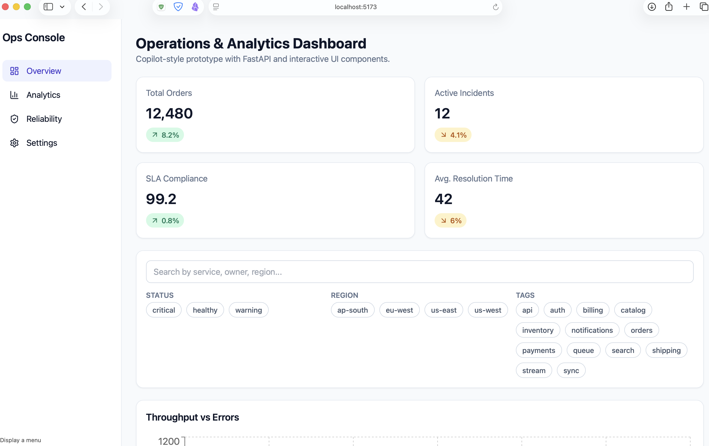

# Operations & Analytics Dashboard

Prototype full-stack app created with assistive AI (GitHub Copilot/GPT-5.3-Codex). Python API code is manually verified.

## UI Preview

> Image asset path: `docs/images/ops-dashboard-overview.png`

## Vision for the app

This repository is a sandbox for two goals:

1. Prototype a modern operations dashboard (KPIs, trends, event monitoring, and quick event creation).
2. Evaluate AI-assisted full-stack workflows (prompting, multi-file generation, contract-first integration, and iteration speed).

It is intentionally **production-shaped but lightweight**: typed API contracts, reusable UI components, deterministic mock data, and containerized local runs.

### What this sandbox is good for
- Testing dashboard UX and interaction patterns quickly.
- Practicing React + FastAPI integration with clear schemas.
- Reusing a starter template for analytics-style internal tools.

### Out of scope (for now)
- Auth/RBAC and multi-tenant access control.
- Persistent database and ingestion pipelines.
- Full observability/compliance hardening.

## Stack
- Frontend: React + TypeScript + Vite + Tailwind + Recharts
- Backend: FastAPI + Pydantic
- Containers: Docker + Docker Compose

## Local run (without Docker)
### Backend
1. `cd backend`
2. Create venv (pick one):
	- `python3 -m venv .venv`
	- or `python -m venv .venv`
	- or (pyenv) `/Users/pabi/.pyenv/versions/3.12.2/bin/python -m venv .venv`
3. Activate venv:
	- `source .venv/bin/activate`
4. Install deps:
	- `python -m pip install -r requirements.txt`
5. Start API backend:
	- `python -m uvicorn app.main:app --reload --port 8000`

### Frontend
1. `cd frontend`
2. `npm install`
3. `npm run dev`

Set `VITE_API_BASE_URL` if needed (default `http://localhost:8000`).
Port for this deployment when running locally is `http://localhost:5173/`.

## Docker Run
From the project/workspace root:
1. `docker compose up --build`
2. Open UI at `http://localhost:8080`
3. API docs at `http://localhost:8000/docs`

## Features in UI and API integration
- Responsive dashboard shell with sidebar and theme toggle
- KPI metric cards
- Search + multi-select filter bar
- Interactive line and bar charts
- Events data table with empty/skeleton states
- Modal-driven event creation wired to FastAPI
